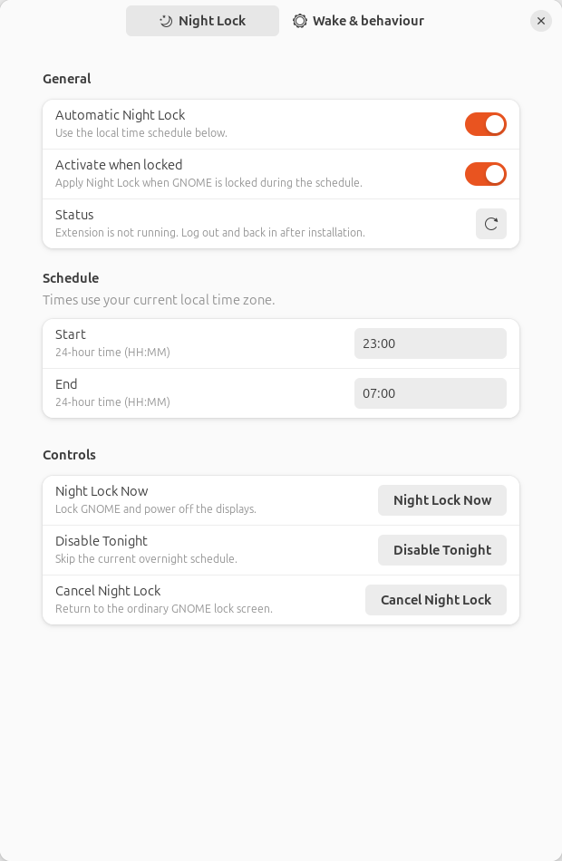
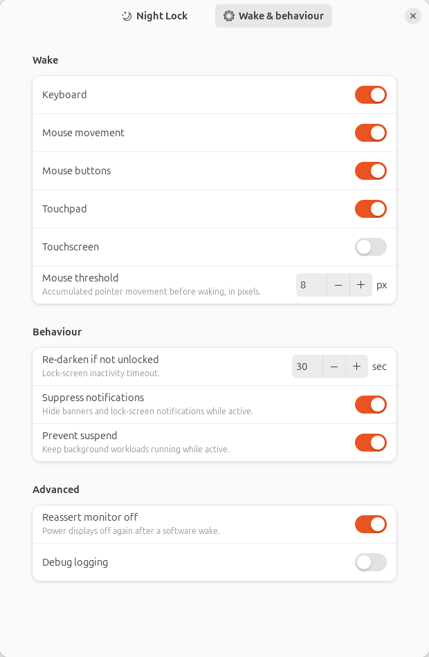
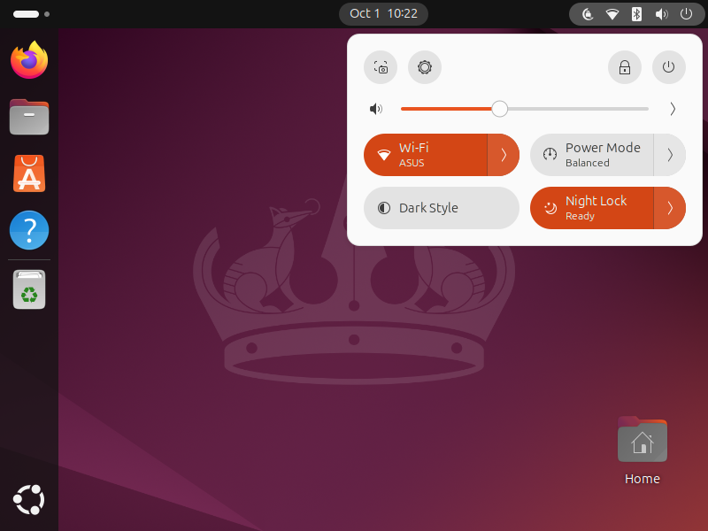

# Night Lock 🌙

A small GNOME Shell 46 extension for Ubuntu 24.04 that keeps overnight work running while the monitors sleep. GNOME continues to handle locking and authentication.

**Development build: physical lock/wake acceptance testing is pending.** The initial target was Wayland; X11 support was added for the development PC at the user's request. The extension loads in GNOME 46, its actual preferences and Quick Settings UI have been exercised, and the logic/platform checks pass. Full overnight, notification, physical input, and multi-monitor tests are not yet complete. See [TESTING.md](TESTING.md).

## Install

```sh
./install.sh
```

No sudo. Log out/in to load a new extension. On **X11**, you can instead press **Alt+F2**, type **r**, and press Enter to restart GNOME Shell while keeping your applications running. Do this when convenient. On Wayland, log out/in; don't restart Shell in place. The installer enables Night Lock for subsequent logins.

Open the top-right system menu: the small moon icon and **Night Lock** Quick Settings tile show its status. Open the tile's arrow for its schedule, **Night Lock Now**, **Disable Tonight**, **Cancel Night Lock**, and **Settings…**. Clicking the main tile toggles Automatic scheduling. The icon/control are hidden on GNOME's authentication screen; the service continues running there.

## How it behaves

- Default automatic schedule: **23:00–07:00**, in local time. Being armed leaves an unlocked desktop alone. Lock during the schedule, or use **Night Lock Now**, to engage.
- A session already locked when the schedule starts engages automatically. Reaching the schedule's end never wakes an active Night Lock session.
- Night Lock powers all displays off through Mutter, suppresses notification visuals, and holds a logind **sleep** inhibitor so work can continue. It doesn't inhibit idle or change automatic-suspend preferences.
- Keyboard, mouse buttons, touchpad activity, or accumulated **8 px** mouse movement approve a wake. Touchscreen wake defaults off. Input remains with the normal GNOME lock screen; nothing automatically unlocks it.
- If you wake the display but don't unlock, **30 seconds** without approved interaction darkens it again. Notification suppression and the sleep inhibitor remain in place until unlock/cancel.
- Unlock, Cancel, or disabling the extension releases its resources and restores saved settings. Turning off **Automatic** only prevents future scheduled activations; **Cancel** ends an active session. **Disable Tonight** cancels and skips the current/upcoming scheduled interval.

Preferences include individual wake switches, motion threshold, inactivity timeout, notification suppression, sleep inhibition, display guard, and debug logging. Equal start/end times mean an empty schedule. Changes to notification/suspend options take effect at the next Night Lock entry; wake and guard options apply live.

## Screenshots

Actual libadwaita preferences on Ubuntu 24.04:




Actual GNOME 46 Quick Settings in an isolated nested compositor on the development PC:



The preferences screenshot used an isolated settings backend, so it correctly reports that its extension service wasn't running. The nested compositor screenshot proves the real Shell control renders; it does not prove physical monitor sleep.

## X11 and hardware limits

Mutter's display property can be stale on X11. Night Lock therefore also uses Ubuntu's `xset` utility **on X11 only**, without a shell, to inspect and force actual DPMS state. It saves/restores X11 monitor-power timeouts because Mutter changes them. A one-second safety check covers changes that bypass Mutter's property signals. Wayland uses Mutter alone with a five-second reconciliation backup.

**X11 cannot provide an absolute physical-input or display-wake guarantee.** Another X11 client can control DPMS or inject input; the extension rejects synthetic flags, virtual/XTEST source devices and other identifiable virtual sources, but this is best effort. Direct X server changes or optical jitter may briefly light a monitor before the guard reasserts OFF. Notification suppression and the compositor guard reduce software wakes; they are not a security boundary. Below-compositor GPU resets, link renegotiation, hotplug and monitor firmware can also cause brief illumination. Unsupported power-saving backends retain the normal GNOME lock and report an error instead of showing a fake black window.

Only GNOME 46 / Ubuntu 24.04 is targeted. No other desktop support, root daemon, custom password screen, PAM changes, password/key-code logging, or user-process termination. This is a local-install project, not a claim of extensions.gnome.org review approval.

## CLI and recovery

A small optional CLI is included in the checkout:

```sh
./scripts/night-lock status
./scripts/night-lock now
./scripts/night-lock cancel
./scripts/night-lock enable
./scripts/night-lock disable
./scripts/night-lock disable-tonight
```

`status` returns JSON inside the standard `gdbus` result. `enable`/`disable` control Automatic scheduling; `disable` also cancels the active session. Session bus interface: `org.gnome.Shell.Extensions.NightLock`, path `/org/gnome/Shell/Extensions/NightLock`. This interface does not grant authentication privileges.

Recovery snapshots are saved before changing notification or X11 DPMS settings. An unlocked startup restores stale snapshots. A locked restart resumes the saved Night Lock session even after its schedule has ended. A one-shot login recovery helper is installed by `install.sh` in case Shell disables extensions after a crash; it is not a background daemon. For recovery after disabling Night Lock:

```sh
gnome-extensions disable night-lock@local
gjs -m scripts/recover.js "$HOME/.local/share/gnome-shell/extensions/night-lock@local" --force
```

Run that from your GNOME session. Recovery leaves GNOME locked if it was locked. A failure retains its snapshot for retry. A Shell process exit naturally closes the sleep inhibitor; persistent settings recover at restart/login or through the helper. Removing a broken extension by deleting its folder before recovery is discouraged.

Uninstall cleanly with:

```sh
./uninstall.sh
```

The installer adds only this extension's enable entry and login recovery helper. Uninstall retains the extension if recovery fails, instead of deleting the only copy of the saved recovery schema.

## Development

Node is only needed for the tests; there are no npm runtime dependencies. GJS, GTK4/libadwaita, GNOME Shell and GLib are supplied by Ubuntu's GNOME desktop. X11 additionally needs `xset` (`x11-xserver-utils`, normally already installed). ZIP building needs `zip`.

```sh
npm test
./tests/run-gi-smoke.sh
./scripts/package.sh
./scripts/logs.sh
```

The last command tails `[NightLock]` journal messages. Debug logging reports input categories only, never typed content or key codes. Don't share unrestricted desktop journal output.

The local-install ZIP is [dist/night-lock@local.zip](dist/night-lock@local.zip). `gnome-extensions install --force dist/night-lock@local.zip` installs the extension, but `./install.sh` is recommended because it also enables it for login and installs the one-shot recovery helper. Restart/log in after any code update; GNOME caches loaded extension modules.

Architecture: [architecture.md](architecture.md). License: [GPL-3.0-or-later](LICENSE).
