# Night Lock architecture

Night Lock runs inside GNOME Shell 46, with `user` and `unlock-dialog` session modes. It uses the existing ScreenShield for authentication and observes the session ScreenSaver bus. It never implements a security screen.

## States and ownership

`lib/stateMachine.js` defines NORMAL, ARMED, ENTERING_NIGHT_LOCK, NIGHT_LOCKED, USER_WAKE, EXITING and ERROR. Only the controller in `extension.js` commits side effects. A generation counter invalidates pending entry/read callbacks after cancel/unlock/error; a per-enable identity prevents an old cleanup callback from clearing a newer recovery record.

```mermaid
stateDiagram-v2
    NORMAL --> ARMED: schedule begins
    ARMED --> NORMAL: schedule ends / disabled
    NORMAL --> ENTERING_NIGHT_LOCK: manual request + confirmed lock
    ARMED --> ENTERING_NIGHT_LOCK: confirmed lock
    ENTERING_NIGHT_LOCK --> NIGHT_LOCKED: resources acquired
    NIGHT_LOCKED --> USER_WAKE: approved device input
    USER_WAKE --> NIGHT_LOCKED: inactivity timeout
    NIGHT_LOCKED --> EXITING: unlock / cancel
    USER_WAKE --> EXITING: unlock / cancel
    ENTERING_NIGHT_LOCK --> EXITING: unlock / cancel
    ENTERING_NIGHT_LOCK --> ERROR: capability / resource failure
    NIGHT_LOCKED --> ERROR: power control failure
    USER_WAKE --> ERROR: power control failure
    ERROR --> EXITING: cancel / unlock
    EXITING --> NORMAL: cleanup; schedule inactive
    EXITING --> ARMED: cleanup; schedule active
```

Schedule end deliberately has no edge out of NIGHT_LOCKED or USER_WAKE. The controller's one-second timer evaluates local clock changes and lock-screen inactivity; it doesn't use session-idle events as wake approval. An explicit cancel is latched across an in-flight normal lock request and cleared at the next successful unlock/manual activation.

## Lock and entry

`LockMonitor` subscribes to `org.gnome.ScreenSaver.ActiveChanged` before querying `GetActive()`. Since ScreenSaver active can mean blanking, the controller additionally requires `Main.screenShield.locked`. The direct locked-changed signal handles authentication state promptly. Manual activation calls the normal ScreenSaver `Lock` method, and display-off waits for the established lock.

Both ScreenSaver and Mutter DisplayConfig live in Shell. Calls to them use asynchronous GIO to avoid a self-D-Bus deadlock. Startup gates schedule/input entry until recovery has been reconciled. The Quick Settings control is removed during unlock-dialog; background lock/input/display signals stay connected as required by this locally installed utility. All owned signals/timers are disconnected on disable. GNOME 46's extension-system source accepts both configured modes; teardown remains unconditional if Shell actually calls disable.

## Display and approved input

`Display` uses `org.gnome.Mutter.DisplayConfig` / `/org/gnome/Mutter/DisplayConfig` and `org.freedesktop.DBus.Properties.Get/Set`. OFF is 3, ON is 0. Unsupported (-1) aborts entry, releases resources and leaves the normal lock available. No black overlay or monitor configuration deletion is used.

PropertiesChanged is the main guard. MonitorsChanged reasserts OFF for a hotplugged display. Unapproved ON/standby/suspend changes are forced back to OFF while NIGHT_LOCKED. USER_WAKE disarms the strict guard before requesting ON. The only wake token is a monotonic timestamp minted by the input monitor; notifications, D-Bus activity and generic session activity never mint one.

On X11, an actual X server DPMS change need not update Mutter's cached property. `Display.getMode()` additionally parses `xset q`; OFF reassertion forces DPMS even if Mutter already says 3. The controller checks once per second on X11, once per five seconds on Wayland. No `xset` is run on Wayland. X11 force commands use a controlled Gio.Subprocess argument array, with no shell or daemon. Pending power writes coalesce to the latest desired state; ON replaces queued OFF work and waits only for an in-flight operation. These paths must still be checked under stalled-bus conditions in live acceptance testing.

`InputMonitor` connects to Clutter stage captured-event while Night Lock is active. It reads event category, flags, source-device classification and pointer coordinates. It does not call character, key symbol or key-code APIs. It requires a physical source device and rejects synthetic/input-method/emulated flags and identifiable virtual/XTEST sources. `MotionAccumulator` sums movement within a fixed one-second window and resets on device change, preventing indefinitely accumulated sensor jitter. Allowed input during USER_WAKE refreshes its inactivity deadline. Rejected wake-capable events can request a throttled OFF reassertion; they cannot grant a token. Events propagate to GNOME's existing lock screen without synthesis or authentication changes.

X11 device filtering is best effort. Direct X server writes can cause illumination until reconciliation, and monitor firmware/kernel events are outside this extension's scope. This implementation does not promise zero flashes or protection from malicious clients.

## Notifications, sleep and recovery

`NotificationManager` snapshots `show-banners` and `show-in-lock-screen`, including whether each had an explicit user value. It syncs the snapshot to GSettings before suppressing visuals. Restore sets the original explicit booleans or resets to inherited defaults; it never assumes true. Failed restoration retains the record. Existing queued notifications aren't deleted.

`SleepInhibitor` calls logind `Inhibit('sleep','Night Lock','Night Lock: background jobs are running','block')` and steals the returned UnixFDList descriptors. It holds the actual inhibitor FD in a GioUnix.InputStream with close_fd; unused copies are closed, and release closes the owned FD immediately. No idle inhibition, power-preference modification or job termination is needed. The call is bounded; rejection aborts entry. Kernel process cleanup releases an inhibitor after Shell exits.

The extension persists `recovery-active` before acquiring resources. On X11, it also saves actual DPMS standby/suspend/off timeouts before Mutter resets them. ON restores them. Cleanup retains the active marker until the final display ON operation succeeds. If a crash interrupts entry/exit, the saved original notification/DPMS snapshot survives. Startup restores stale state when unlocked; a locked restart resumes active Night Lock without briefly unsuppressing notifications.

`lib/recover.js` is a one-shot helper. The installer creates a login autostart entry so settings can recover if Shell disabled extensions after a crash. It avoids touching a live Night Lock owner and only performs ordinary login recovery while ScreenSaver is inactive. Explicit forced recovery after disable waits for the bus owner to disappear, restores visuals/power, and refuses to report success with recovery records remaining. Uninstall aborts when recovery fails. This isn't a same-session watchdog: following an unrecovered Shell crash, restart/login or explicit recovery may be needed.

## Interfaces and dependencies

The moon/SystemIndicator and QuickMenuToggle use GNOME 46's Quick Settings API. Preferences use GTK4/libadwaita and a private schema. The optional CLI calls the exported session-bus methods GetStatus, Now, Cancel, DisableTonight, Enable and Disable. D-Bus callers can request a normal lock/cancel or scheduling changes but never create approved input or unlock the session.

Runtime: GNOME Shell/GJS/GLib/GIO, GTK4/libadwaita for preferences, and `xset` on X11. No npm package, privileged daemon, service running continuously as root, or cross-desktop layer. Tests use Node for pure logic/controller fakes and GJS for isolated setting recovery plus live read-only interfaces and inhibitor lifetime checks.

## Primary implementation references

- [GNOME 46 extension session-mode implementation](https://github.com/GNOME/gnome-shell/blob/gnome-46/js/ui/extensionSystem.js)
- [GNOME 46 ScreenShield](https://github.com/GNOME/gnome-shell/blob/gnome-46/js/ui/screenShield.js)
- [GNOME 46 ScreenSaver service](https://github.com/GNOME/gnome-shell/blob/gnome-46/js/ui/shellDBus.js)
- [Mutter 46 DisplayConfig contract](https://github.com/GNOME/mutter/blob/gnome-46/src/org.gnome.Mutter.DisplayConfig.xml)
- [Mutter 46 X11 DPMS implementation](https://github.com/GNOME/mutter/blob/46.2/src/backends/x11/meta-monitor-manager-xrandr.c)
- [GJS session modes](https://gjs.guide/extensions/topics/session-modes.html), [Quick Settings](https://gjs.guide/extensions/topics/quick-settings.html)
- [logind inhibitor API](https://www.freedesktop.org/software/systemd/man/latest/org.freedesktop.login1.html)
- [GIO Unix FD ownership](https://docs.gtk.org/gio/method.UnixFDList.steal_fds.html), [GSettings original user values](https://docs.gtk.org/gio/method.Settings.get_user_value.html)

GNOME private Shell/Clutter APIs require version-specific maintenance. Only shell-version 46 is declared.
